# Retail Sales Forecasting & Store Segmentation with KNIME

An end-to-end data science project for analysing retail branch performance, forecasting daily sales, and identifying meaningful store segments. The solution was built in KNIME and combines data-quality engineering, XGBoost regression, model evaluation, and k-means clustering.

> Academic team project completed at Technische Hochschule Mittelhessen (THM) during the 2026 summer semester.

## Project overview

The project addresses three practical questions:

1. How can inconsistent store and sales data be transformed into an analysis-ready dataset?
2. How accurately can future daily sales be predicted without using leakage-prone variables?
3. Can stores be grouped into useful performance segments for differentiated business decisions?

The work is organised into three KNIME workflows:

| Workflow | Purpose | Main techniques |
| --- | --- | --- |
| `01-data-preparation.knwf` | Data profiling, cleaning, validation, and integration | Missing-value handling, duplicate removal, rule-based validation, joins |
| `02-xgboost-forecasting.knwf` | Daily sales forecasting and error analysis | Chronological split, one-hot encoding, XGBoost regression, MAE/RMSE/MAPE, interactive views |
| `03-store-clustering.knwf` | Store-level segmentation | Aggregation, normalisation, k-means, silhouette analysis, PCA visualisation |

## Data science pipeline

```text
Raw sales + store master data
              │
              ▼
     Quality checks and cleaning
              │
              ▼
       Integrated feature table
          ┌───┴────────────┐
          ▼                ▼
  XGBoost forecasting   Store aggregation
          │                │
          ▼                ▼
  Error and feature     k-means clustering
  importance analysis   and PCA analysis
```

## Key results

- Removed all identified missing values, duplicate store-date records, implausible values, and consistency violations from the modelling table.
- Used a chronological train/test split rather than a random split to better represent real forecasting conditions.
- Trained the final model on `92,592` observations and evaluated it on `6,891` later observations.
- Found that competition distance, promotion activity, and calendar variables were among the most influential predictors.
- Observed that the largest forecasting errors occurred on unusually high-sales days.
- Identified three store segments after removing one extreme outlier (`Store 765`):

| Segment | Stores | Average sales | Interpretation |
| --- | ---: | ---: | --- |
| Cluster 0 | 199 | 6,151 | Medium-performing stores |
| Cluster 1 | 99 | 9,472 | High-performing stores |
| Cluster 2 | 101 | 6,100 | Similar sales level to Cluster 0, but a distinct multivariate profile |

These results suggest that the high-performing segment may benefit from a dedicated forecasting model or tailored commercial strategy.

## Workflow previews

### 1. Data preparation



### 2. XGBoost forecasting



### 3. Store clustering



## Repository structure

```text
.
├── data/
│   └── README.md
├── docs/
│   ├── project-report-de.pdf
│   └── workflow-previews/
├── workflows/
│   ├── 01-data-preparation.knwf
│   ├── 02-xgboost-forecasting.knwf
│   └── 03-store-clustering.knwf
├── .gitignore
└── README.md
```

## How to run the project

1. Install [KNIME Analytics Platform](https://www.knime.com/downloads).
2. Install any extensions requested by KNIME when opening the workflows, including the XGBoost integration used by the forecasting workflow.
3. Obtain the authorised source datasets and place them in `data/` using the filenames documented in [`data/README.md`](data/README.md).
4. Import the `.knwf` files from `workflows/` into KNIME.
5. If KNIME asks for a data location after import, point each CSV Reader to the corresponding file in `data/`.
6. Execute the workflows in numerical order.

All personal absolute file paths from the original school submission were replaced with portable workflow-relative paths.

## Methodological choices

- **Time-aware evaluation:** training data ends on 31 May 2015; later records form the test set.
- **Leakage control:** `Customers` was excluded from the main prediction model because it would not normally be known before the sales day. `Open` was constant after filtering and was also excluded.
- **Interpretability:** the selected final model excludes the store identifier, improving the usefulness of global feature importance while retaining competitive predictive performance.
- **Comparable clustering features:** store-level metrics were normalised before k-means so that variables with larger numerical scales did not dominate the distance calculation.

## Limitations and next steps

- The cleaning rules depend on domain assumptions and should be validated with business stakeholders.
- External drivers such as weather, local events, purchasing power, and competitor activity were not available.
- Cluster assignments depend on feature selection, scaling, and the chosen number of clusters.
- A future version could compare XGBoost with time-series baselines, add cross-validation adapted to temporal data, and train segment-specific models.

## Documentation

The complete German-language academic report is available at [`docs/project-report-de.pdf`](docs/project-report-de.pdf).

## Authors

Academic group project by Kana Tezo, Moumani Tchokote, Pokem Tezo, and Mamo Tiotsap.

## Data and licensing

The CSV files are intentionally excluded from this public repository because their redistribution rights were not included with the submitted archive. This repository therefore contains the workflows and documentation only. No licence is granted for the project materials unless the authors add one explicitly.
